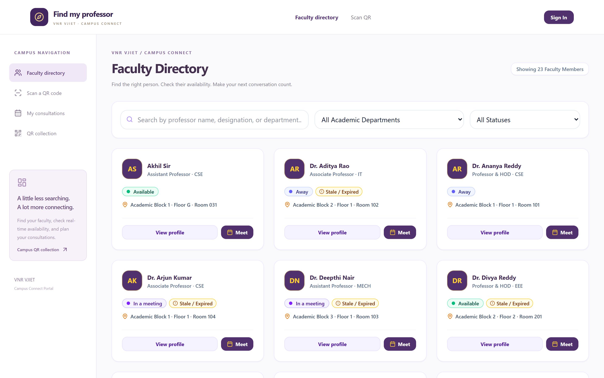
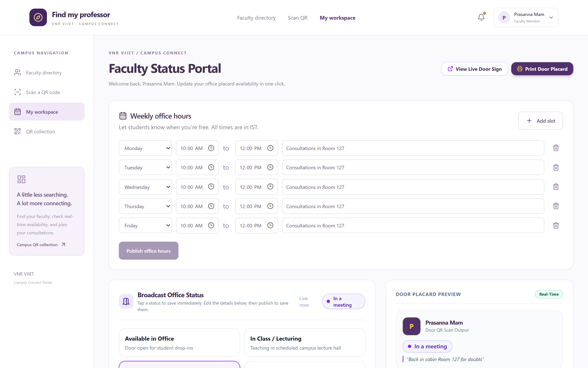
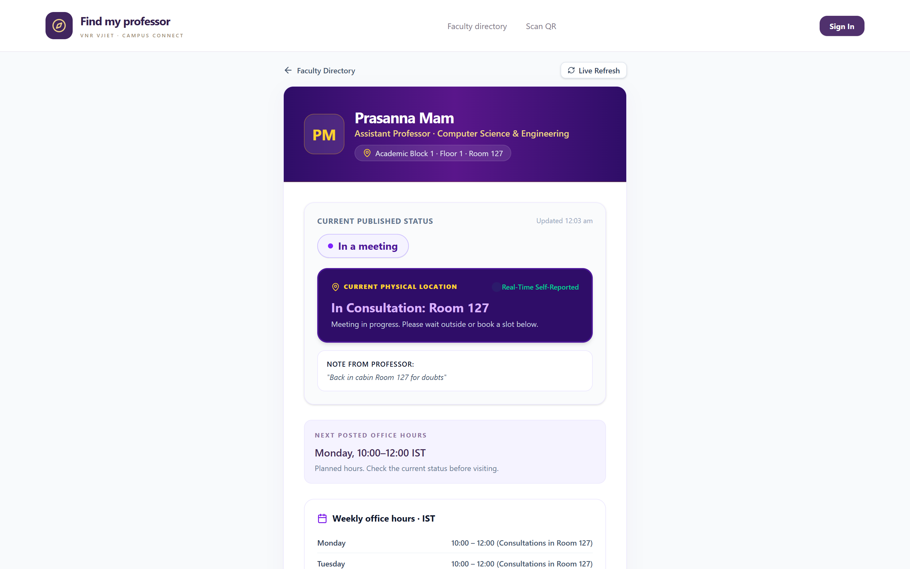
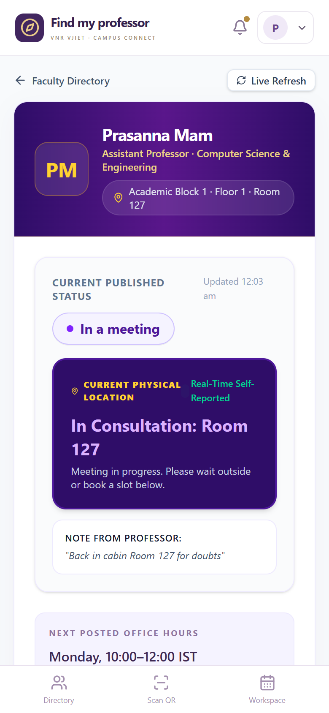
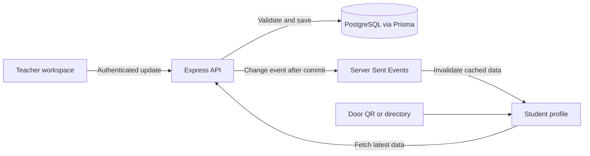

<div align="center">

# Find My Professor

**Check faculty availability before you make the trip.**

A campus web app connecting students and faculty through live availability, QR-linked profiles, published schedules, and consultation requests.

[](https://github.com/saikoushikpallapolu/Find-My-Professor/actions/workflows/render-production.yml)   

[Open the app](https://dt-2026.onrender.com) · [Explore a profile](https://dt-2026.onrender.com/qr/vnr-ananya-reddy) · [Run locally](#run-locally) · [Try the live workflow](#try-the-live-workflow)

</div>

<a href="https://dt-2026.onrender.com/directory">
  
</a>

## The problem

A student needs a project review, a signature, or help with coursework. They walk to a professor's cabin, only to find that the professor is teaching, in a meeting, or away. A nameplate identifies the office but cannot explain whether to visit now or when to return. Faculty receive the same availability questions repeatedly, alongside unplanned interruptions.

**Find My Professor makes that information available before the visit.** Teachers publish their status and consultation hours in one place. Students check the directory or scan a door QR, read the latest report, and request a meeting when a drop-in is unsuitable.

| Campus friction | How the app addresses it |
| --- | --- |
| Uncertainty before walking to an office | A public profile shows published availability, update time, office location, and an optional return estimate. |
| Paper notices become outdated | A stable QR opens a database-backed profile that changes without reprinting the code. |
| Consultation plans are scattered across messages | Weekly hours and dated meeting requests provide a structured planning workflow. |
| Students cannot tell whether a request was approved | Pending, accepted, declined, and cancelled states make the outcome visible. |

The intended outcome is fewer unnecessary visits and clearer communication. Actual time savings and adoption need to be measured in a campus pilot.

## Product tour

### A workspace for faculty

Publish recurring office hours, update availability, and respond to consultation requests. Student profiles reflect saved changes through live refreshes.



### A profile students can open anywhere

The same faculty identity works through the directory, a direct link, and a printed QR. Desktop and mobile views present status, notes, office details, and consultation information.

<table>
  <tr><th>Faculty profile</th><th>Mobile experience</th></tr>
  <tr>
    <td width="68%" valign="top"></td>
    <td width="32%" valign="top"></td>
  </tr>
</table>

<sub>Screenshots are demo captures with sample identities, rooms, and schedules. The current app also includes a weekly class timetable.</sub>

## What you can do

| Role | Capabilities |
| --- | --- |
| **Student** | Search and filter faculty; view public profiles; scan QR codes; bookmark professors; subscribe to availability notifications; request, track, and cancel consultations. |
| **Professor** | Publish status, a public note, alternate location, and expected return; edit weekly office hours and class timetable; accept or decline requests; review status history. |
| **Administrator** | Manage faculty, departments, buildings, and offices; generate or revoke QR codes; inspect analytics and audit records. |

Public profiles do not require a login. Personal actions require the appropriate account, with permissions enforced on the server.

## Try the live workflow

Open the [teacher dashboard](https://dt-2026.onrender.com/faculty/dashboard) on one device and [Ananya's student-facing profile](https://dt-2026.onrender.com/qr/vnr-ananya-reddy) on another.

1. **Publish a status.** Sign in as Ananya, choose **In Class**, add a distinctive note, and publish. Watch the student profile update without manually reloading.
2. **Change office hours.** Edit a day, time, or note and select **Publish office hours**. Students see the revised slots and next planned consultation window.
3. **Publish a timetable.** Add a class slot with subject and classroom details in its note, then publish. The student's weekly class timetable updates.
4. **Request a consultation.** Sign in as the student and propose a future meeting. It appears as pending in the teacher's queue.
5. **Accept or decline.** Respond as the teacher. The student sees the new state and an in-app notification.
6. **Verify persistence.** Reload the profile and inspect status history. Published data exists independently of the current page.

Use separate devices, browsers, or browser profiles for simultaneous roles. Normal tabs in one browser share the session cookie.

### Demo accounts

The shared demo password is **`DemoPass123!`**.

| Role | Email |
| --- | --- |
| Student | `student@vnr.demo` |
| Professor | `ananya.reddy@vnr.demo` |
| Second professor | `vikram.rao@vnr.demo` |
| Administrator | `admin@vnr.demo` |

These credentials are intentionally public for the demonstration. Use sample information; replace this identity setup before an institutional rollout.

## How it works



- **Stable identity:** A stored QR token resolves to a professor. The QR contains the profile URL, not a copy of a changing status.
- **Checked writes:** The API resolves the session, checks role and ownership, validates input, and saves data. Related status, history, and audit writes use a transaction.
- **Fresh reads:** A `campus-change` event tells React Query to refresh active data. Polling, reconnects, and screen-focus refreshes help recover when live events are interrupted.
- **Traceable changes:** Status history, meeting transition events, notifications, and audit records provide context beyond the latest screen state.

The global polling fallback runs every two seconds on visible screens; some pages also have their own intervals. Network conditions and browser background throttling affect timing.

### Three different kinds of availability

| Information | Meaning |
| --- | --- |
| **Live status** | The teacher's report: Available, In Class, In Meeting, Away, On Leave, or Unknown. Expired reports are marked stale. |
| **Weekly schedules** | Recurring class plans and consultation hours in IST. Timetable edits do not automatically change live status. |
| **Meeting requests** | A specific future date and time proposed by a student, requiring teacher approval. Requests may be outside office hours. |

Schedule validation rejects invalid time ranges and overlapping entries within the same submitted schedule. Accepted-meeting overlaps are checked separately. The prototype does not enforce a combined conflict rule across classes, office hours, and appointments.

## Technology stack

| Layer | Technologies | Responsibility |
| --- | --- | --- |
| Frontend | React 19, TypeScript, React Router | Screens, typed components, and routing |
| Server data | TanStack React Query | Fetching, caching, invalidation, and refresh |
| Styling and build | Tailwind CSS 4, custom CSS, Vite 6 | Responsive interface and frontend bundling |
| API | Node.js, Express 4, Zod | Requests, business rules, and runtime validation |
| Persistence | PostgreSQL, Prisma 6 | Relational records, migrations, and transactions |
| Authentication | bcryptjs, opaque cookie sessions | Password hashing and database-backed sessions |
| Live updates | SSE, polling, BroadcastChannel | Cross-device refresh and same-browser tab signals |
| QR | `qrcode`, `html5-qrcode` | Generate profile codes and support browser scanning |
| Verification | Vitest, Supertest, Playwright, Node test runner | Unit, API, browser, and deployment-verifier checks |
| Hosting | Render, GitHub Actions | App deployment and verified Production records |

## Run locally

### Requirements

- **Node.js 22 or newer** and npm.
- Available ports **55432** for the demo database and **4100** for the API.
- A browser. The mobile verification scripts use Microsoft Edge.

```bash
git clone https://github.com/saikoushikpallapolu/Find-My-Professor.git
cd Find-My-Professor
npm install
npm run demo
```

The runner starts or reuses an isolated embedded PostgreSQL instance, applies migrations, provisions sample accounts, and launches the API and Vite. Docker is not required for this path. Open Vite's printed URL, usually **http://localhost:5173**; it can choose another port if needed. Keep the terminal running and stop with **Ctrl+C**.

Data persists in `.demo-pgdata`. Stop an older demo before starting another instance. Avoid `db:reset` and the legacy seed against data you want to keep.

### Open it on a phone

For hosted access, open **[dt-2026.onrender.com](https://dt-2026.onrender.com)** from any reachable network.

Locally, connect phone and computer to the same Wi-Fi and use Vite's printed **Network** URL. The address can change, and guest Wi-Fi may block device-to-device access. `localhost` on a phone refers to the phone itself.

In-browser scanning requires HTTPS or localhost and camera permission. On a plain HTTP LAN URL, use the phone's native QR scanner, upload a QR image, or open a profile directly. Rehearse camera access on the actual device.

## Verification

| Command | What it checks |
| --- | --- |
| `npm test` | Shared status logic, office-hour validation, and foundation API behavior |
| `npm run build` | Workspace TypeScript checks and the production frontend bundle |
| `npm run demo:verify` | QR identities, roles, saved status and hours, approval, notifications, booking conflicts, and cancellation |
| `node scripts/verify-dynamic-mobile.mjs` | Separate teacher/student mobile-width sessions, timetable edits, live updates, persistence, permissions, and polling fallback |
| `node scripts/verify-hosted-mobile.mjs` | Student login and faculty profile rendering on the hosted app |
| `node --test scripts/verify-render-deployment.test.mjs` | Rejects older or incomplete deployments and accepts matching healthy revisions |

Start the local demo before workflow and mobile checks. Demo checks perform sample-account writes and leave audit/notification records; the mobile script restores the original status and schedules in cleanup. The hosted smoke check signs in and reads data.

The original integration suite, `npm run test:legacy -w @wimp/backend`, expects a separate disposable database with the legacy seed. It is not part of normal demo setup.

## Deployment

Render builds and deploys the linked `main` branch. Express serves the frontend and `/api/v1` from one HTTPS origin. [`render.yaml`](render.yaml) describes the service and database; production startup applies migrations and provisions demo accounts.

The [Production workflow](.github/workflows/render-production.yml) runs alongside Render. It waits for the **exact pushed commit** to be live, then checks API health, database-backed faculty data, the login page, and its JavaScript bundle. GitHub records success only after those checks pass. This is deployment verification, not a full app test gate before Render deploys.

Keep Render auto-deploy set to deploy on commit; making it wait for this verification job would create a circular dependency. See [deployment tracking](docs/github-deployments.md) for details. Preview deployments are not configured.

## Repository guide

```text
frontend/src/          Pages, components, API client, and authentication context
backend/src/           Express routes, middleware, status logic, and live events
backend/prisma/        Data model, migrations, and sample-account provisioning
shared/src/            Shared types, enums, and status-freshness rules
scripts/               Demo startup, verification, QR, and presentation utilities
docs/                  Implementation notes and deployment documentation
presentation_assets/   Product screenshots and presentation graphics
presentation-guide/    Presentation guides and editable source material
.github/workflows/     Production deployment verification
```

**Presenting the project?** Read the [four-page guide](presentation-guide/Find_My_Professor_FOUR_PAGE_GUIDE.docx) or its [Markdown source](presentation-guide/four-page-content.md).

## Scope and next steps

This student project was developed in the VNR VJIET campus context. Demo profiles and room assignments are illustrative; it is not an official college directory or an institutional production service.

- **Teacher-reported information:** No GPS or occupancy sensing. Return times are estimates; stale status is not confirmation of presence.
- **In-app communication:** Email, SMS, native push, and offline operation are not implemented.
- **Production hardening:** College SSO, controlled onboarding, login throttling, privacy review, backups, and monitoring remain necessary.
- **Booking concurrency:** Sequential conflicts are checked; concurrent acceptance needs a database constraint or serializable retry before larger-scale use.
- **Multiple instances:** Live events use a process-local emitter. Shared event distribution and more targeted refreshes would support scaling.

Next steps are a measured student/faculty pilot, stronger identity and booking guarantees, accessibility and device testing, and optional calendar integrations.

## Contributing

Open an [issue](https://github.com/saikoushikpallapolu/Find-My-Professor/issues) with expected behavior and reproduction steps. Work on a branch, run relevant checks, and open a pull request explaining the user-visible result. Include before/after captures for interface changes, using demo data.
